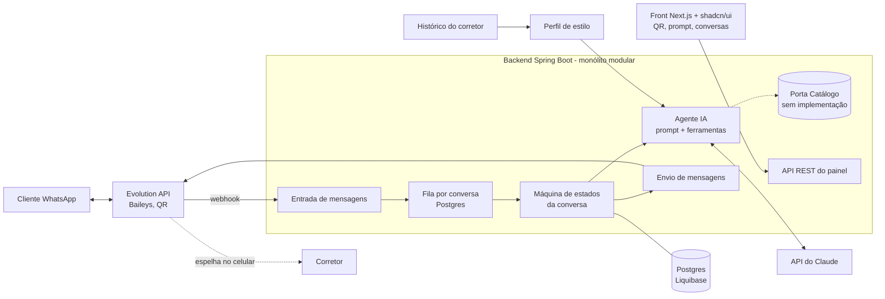
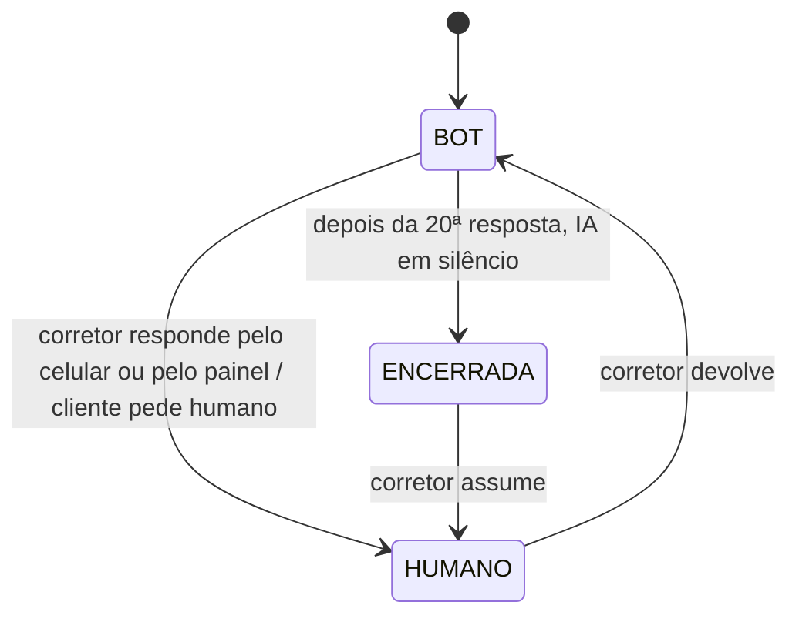

# Arquitetura do Bizu: atendente de IA no WhatsApp (corretor)

**Paradigma:** monólito modular em Java/Spring Boot, orientado a eventos de mensagem, com máquina de estados por conversa. Um processo de backend, um banco, um front. WhatsApp, IA e catálogo ficam atrás de portas (interfaces) trocáveis.

## Diagrama

## Decisões (AD)

**AD-1 Backend: monólito modular em Java com Spring Boot e Postgres.**
- Binds: toda a lógica, conversas, fila, API.
- Prevents: microsserviços e Redis prematuros; dados divergentes entre serviços.
- Rule: um deploy de backend, um banco. Módulos: `conversa` (núcleo: estados, fila, leads, portas `Canal` e `Agente`), `whatsapp` (webhook e adaptador da Evolution), `agente` (adaptador da IA, Claude por `BIZU_AGENTE=claude`), `painel` (login e API do prompt). Os módulos de borda dependem do núcleo, nunca o contrário. Fronteiras verificadas com Spring Modulith; módulo só chama outro pela interface pública.

**AD-2 Esquema do banco versionado com Liquibase, em changelogs SQL.**
- Binds: toda mudança de tabela.
- Prevents: alteração manual de banco e divergência entre ambientes.
- Rule: arquivos `.sql` no formato Liquibase (`--liquibase formatted sql`), um por mudança, em `db/changelog/`, listados pelo changelog mestre. Nunca editar um changeset já aplicado; criar um novo. Hibernate não gera esquema (`ddl-auto=none`).

**AD-3 WhatsApp atrás de uma porta `Canal`, implementada pela Evolution API (Baileys, QR).**
- Binds: tudo que envia ou recebe mensagem.
- Prevents: acoplar o domínio a uma biblioteca não oficial e travar a migração para a Cloud API da Meta.
- Rule: o domínio usa só `Canal.enviar()` e o evento `MensagemRecebida`. O webhook do backend exige segredo compartilhado com a Evolution. Evolution roda em Docker com tag fixa. A licença da Evolution proíbe uso como SaaS multi-cliente sem autorização escrita; serve para um corretor.

**AD-4 Conversa é uma máquina de estados persistida: BOT, HUMANO, ENCERRADA.**
- Binds: CAP-4, CAP-5.
- Prevents: IA e corretor respondendo juntos; 21ª mensagem.
- Rule: estado e contador `respostas_ia` ficam no banco e mudam na mesma transação que grava a mensagem enviada. Mensagem enviada pelo corretor (`fromMe` cujo ID não está entre os IDs que o sistema enviou) leva a HUMANO; o eco de uma mensagem da IA é descartado pelo ID. A IA só envia se o estado for BOT. O contador é por conversa. Devolver a conversa à IA não zera o contador. Após 7 dias sem nenhuma mensagem do cliente nem do corretor, uma nova mensagem do cliente abre uma nova conversa com contador 0, só se o AD-8 ainda considerar o número cliente novo.

**AD-5 Fila por conversa, processamento serial, com agrupamento de rajadas.**
- Binds: ordem das respostas e custo de IA.
- Prevents: respostas duplicadas e corrida no contador.
- Rule: fila em tabela do Postgres, consumida com `FOR UPDATE SKIP LOCKED`, uma conversa por vez. Janela de 3 a 5 s junta mensagens do cliente antes de chamar a IA. Pequeno atraso antes de enviar, para soar natural.

**AD-6 O agente usa chamada de ferramentas; dado de imóvel só vem de uma porta `Catalogo`, hoje sem implementação.**
- Binds: CAP-2, CAP-3 e a regra de não inventar dado.
- Prevents: alucinação de preço e retrabalho quando o catálogo chegar.
- Rule: ferramentas do agente: `registrar_qualificacao`, `registrar_imovel_citado`, `passar_ao_corretor` (muda a conversa para HUMANO sem enviar nada ao cliente). A porta `Catalogo` (buscar, detalhe) existe como interface; sem implementação, o agente não afirma dados de imóvel. A próxima feature implementa a porta e adiciona as ferramentas de catálogo. O prompt de agente fica no banco, editável pelo painel. Modelo: Claude via SDK Java da Anthropic, modelo menor no dia a dia, versão verificada no deploy.

**AD-7 Sem anúncio de IA; sem afirmar ser humana a quem pergunta diretamente.**
- Binds: prompt do agente e testes.
- Prevents: engano direto do cliente (risco legal e de confiança).
- Rule: a IA não se apresenta como IA, mas não afirma ser pessoa se perguntada de forma direta. Teste automatizado com perguntas como "você é robô?". Essa ressalva é minha, o usuário não a decidiu.

**AD-10 Estilo do corretor vem de um perfil derivado do histórico dele, não de conversas cruas.**
- Binds: CAP-7 e o prompt do agente.
- Prevents: enviar dados de terceiros à IA em cada chamada; custo alto de contexto.
- Rule: ao conectar, um job lê as mensagens enviadas pelo corretor (histórico que o Evolution entregar), gera um perfil de estilo e o grava em `prompt_agente`, anexado ao prompt. Só mensagens recentes do corretor entram. Se o histórico for curto demais, o perfil não é gerado e vale o tom formal padrão; com perfil, o estilo do corretor prevalece sobre a formalidade. Refeito sob demanda pelo painel. Sem aprovação prévia de respostas.

**AD-8 Comportamento reativo para limitar banimento.**
- Binds: módulo `whatsapp`.
- Prevents: disparo em massa e padrão de spam.
- Rule: só responde a quem escreveu primeiro e só para cliente novo, isto é, número que não está nos contatos salvos do corretor (quando o WhatsApp entregar a agenda) e sem nenhuma mensagem anterior escrita manualmente pelo corretor àquele número no histórico disponível (mensagens enviadas pelo sistema não contam, por isso o cliente que já conversou com a IA continua elegível); sem envio ativo; limite de envios por minuto; alerta ao corretor se a sessão cair.

**AD-9 Front em Next.js (TypeScript) com shadcn/ui, só como cliente da API REST do backend.**
- Binds: painel mínimo (QR, prompt, conversas).
- Prevents: regra de negócio no front; dois pontos de verdade.
- Rule: o front não acessa o banco nem a Evolution; tudo passa pela API do backend. Login com Google (OIDC) validado no backend, só para o e-mail do corretor configurado; o backend emite um JWT de sessão (HS256, 8 h) e a API só aceita esse JWT. Pastas `backend/` e `frontend/` na raiz.
- Implementado no módulo `painel`: `POST /api/auth/google` (corpo `{idToken}`, devolve `{token, expiraEm}`; 401 token inválido, 403 outra conta), `GET /api/prompt` e `PUT /api/prompt` (corpo `{base}`, máximo 8000 caracteres). `GET` devolve `base` (editável), `estilo` e `regrasFixas` (somente leitura). Variáveis de ambiente: `GOOGLE_CLIENT_ID`, `BIZU_EMAIL_CORRETOR`, `BIZU_JWT_SEGREDO` (mínimo 32 caracteres; sem ele a aplicação não sobe), `BIZU_PAINEL_ORIGEM` (padrão `http://localhost:3000`). O webhook da Evolution fica fora do JWT e se protege pelo segredo no header.

## Pilha (seed, o código passa a ser dono depois)

Java 21, Spring Boot 4.1, Spring Modulith 2.1, Spring JDBC (`JdbcClient`, SQL explícito, sem JPA), Liquibase, Postgres, Evolution API (Docker, tag fixa), SDK Java da Anthropic; Next.js, React, shadcn/ui, Tailwind. Versões a fixar no início do código.

## Dados principais

`corretor`, `conversa(estado, respostas_ia, telefone_cliente)`, `mensagem(direcao, origem: cliente|ia|corretor)`, `lead(finalidade, regiao, faixa_valor, prazo, imovel_citado)`, `prompt_agente`, `fila_mensagem`.

## Deploy

Um VPS pequeno com Docker Compose: backend, frontend, Postgres, Evolution. HTTPS na frente (webhooks e painel). Backup diário do Postgres e da sessão do Evolution; sem ela o QR precisa ser lido de novo.

## Encaixe das próximas features

Catálogo e agenda ficam num **microsserviço** do dashboard, com banco próprio no futuro, ou o backend do WhatsApp consulta o banco do dashboard (decisão do usuário, a escolher quando a feature chegar). Em qualquer caso o backend do WhatsApp só lê o catálogo, por uma implementação da porta `Catalogo` (leitura de banco com usuário só de leitura, ou chamada à API do dashboard), e cada serviço é dono do seu esquema e dos seus changelogs Liquibase. Os itens do catálogo e os do dashboard são os mesmos registros. O dashboard (telas de catálogo e agenda) entra no `frontend/` e o agente ganha ferramentas de catálogo e `propor_horario`. Nada disso muda AD-1 a AD-10.

## Deferred

- Modelo final (o custo já é limitado pelas 20 respostas por conversa).
- Como o backend do WhatsApp acessa o catálogo: banco do dashboard em leitura ou API (porta `Catalogo`).
- Entrada de áudio (transcrição).
- Migração à Cloud API oficial e multi-cliente (muda AD-3 e a licença).

## Assumptions

- [ASSUMPTION] Um corretor, um número, pt-BR.
- [ASSUMPTION] VPS próprio, sem serviço gerenciado.
- [ASSUMPTION] Evolution API em vez de Baileys direto, por ter REST, webhooks e tela de QR prontos; trocável pela porta `Canal`.
- [ADOPTED] O histórico entregue pelo WhatsApp ao vincular pode ser parcial; o perfil de estilo usa o que vier.
- [ADOPTED] Pedido de humano pelo cliente: IA em silêncio até o corretor assumir.
- [ASSUMPTION] Painel mínimo entra nesta versão (QR, prompt, conversas), pois sem ele o corretor não conecta nem assume conversas.
